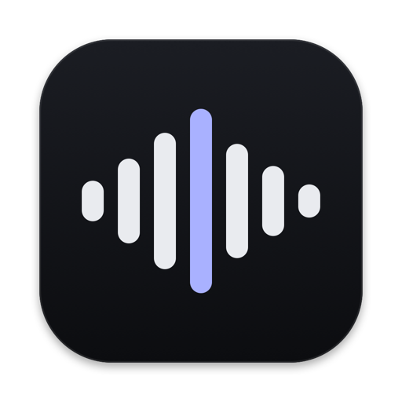

<p align="center">
  
</p>

# Sound Tools

A small DAW that an AI agent can work in. A project is a folder of small JSON files, and the running app applies every change to them live, so an agent adds a part by writing a file and you hear it without a build. The agent sidebar runs Claude Code in the project folder. Any coding agent in a terminal works too.

What a new project can start from: Bare, an empty project, or a DAW written in TypeScript as any tool of a project, with instrument and audio tracks, clips with notes or audio, a synth, a Wavetable, a Sampler, a Drum pad, CLAP and VST 3 plugins, twelve effects (Filter, Compressor, Gate with a transient shaper, Limiter, EQ, Delay, Reverb, Saturator, Utility, Modulation: a chorus, flanger and phaser, a Vocoder that another track's voice keys, and Pitch correction), an Analyzer that shows the spectrum, level and pitch of a track, a mixer with a limited master, and MIDI and audio recording. Change any of it, or ask the agent to.

## Requirements

- macOS 11 or later, the main platform. Linux and Windows build from source too, see "Linux" and "Windows" below.
- To build it: Rust through `rustup`. `rust-toolchain.toml` pins the version and `rustup` installs it on the first build.
- The first build takes about a minute, plus the download of the dependencies. Later builds take seconds.
- Every checkout builds into its own `target/`, so a new worktree starts with a full build. One shared folder let worktrees on different commits overwrite each other's files, and tests ran the wrong code. `tooling/clean-builds.sh` deletes the builds of worktrees nobody used for two days. With [sccache](https://github.com/mozilla/sccache) as the `rustc-wrapper` in `~/.cargo/config.toml`, a new worktree reuses the dependencies other worktrees compiled, safely when several build at once. That makes its first build about 30% faster: crates with build scripts, gpui among them, build again in each folder.

### Linux

Linux x86_64 and arm64 build from source, and CI runs the tests on Ubuntu. On Ubuntu or Debian, install:

```sh
sudo apt-get install build-essential pkg-config libasound2-dev libpipewire-0.3-dev \
  libdbus-1-dev libclang-dev libfontconfig-dev libfreetype-dev libwayland-dev libx11-xcb-dev \
  libxkbcommon-x11-dev libvulkan1 mesa-vulkan-drivers
```

Then build and run as on macOS. The window needs Vulkan: a graphics driver, or `mesa-vulkan-drivers` for a software one.

CI builds and tests on Ubuntu. Playback, MIDI, recording and plugins go through ALSA and should work, but nobody has tried them on a real Linux desktop yet. Plugins are looked for in `~/.clap` and `/usr/lib/clap`, and in `~/.vst3`, `/usr/lib/vst3` and `/usr/local/lib/vst3`. The plugin cache is in `~/.cache/sound-tools/`.

A release has a tarball for x86_64 and one for aarch64, see "Releases". `tooling/bundle-linux.sh` makes it: the program, Bun, a menu entry, the icon and `install.sh`, which puts them in `~/.local`. It needs glibc 2.39 or later (Ubuntu 24.04 or newer) and the runtime libraries the page of the release names, not the `-dev` packages above.

With no folder, `runtime` opens the last project, which it keeps in `~/.config/sound-tools/`, or else a folder panel. The panel needs the XDG desktop portal, which GNOME and KDE have. **Install command line tool** links `sound-tools` into `~/.local/bin`.

Not on Linux:

- Plugin windows. The card of a plugin has `Open window` greyed out and says why. The plugin plays, and its state is saved.
- The snapshot tests. They render with Metal, so on Linux they only say so. The rest of the tests run.
- **Open terminal in project folder** starts `$TERMINAL`, or else `x-terminal-emulator`, so it needs one of the two.

### Windows

Windows 10 or later, x86_64. CI builds and tests it on Windows, but nobody has tried it on a real Windows computer yet. To build it you need Rust through `rustup` and the Visual Studio Build Tools with the "Desktop development with C++" workload.

- The app keeps the last project, agents, updates and the sample library in `%LOCALAPPDATA%\Sound Tools`, and the plugin cache in its `Cache` folder.
- Plugins are looked for in `%COMMONPROGRAMFILES%\CLAP` and `%LOCALAPPDATA%\Programs\Common\CLAP`, and the same two folders with `VST3`. Plugin windows open, but typing into a plugin's own text fields likely does not work yet: gpui keeps the keys.
- There is no **Install command line tool**: the setup program puts the `sound-tools` command on your `PATH`. Run from a terminal, the command line forms print after the prompt comes back, because the program is a window program. Pipe it (`| more`) to wait for it.
- **Open terminal in project folder** opens Windows Terminal, or else a Command Prompt.
- The snapshot tests render with Metal, so on Windows they only say so.
- The Claude Code agent uses PowerShell for its commands, and Bash too when Git for Windows is installed.

## Run it

```sh
cargo run -p runtime -- ~/Music/my-piece
```

The folder is the project. When it is empty or missing, the app makes a Bare project in it: 120 bpm, 4/4 and nothing else. A folder with other files and no project does not open. There is no save: every finished edit is in the folder.

### Install the app

```sh
tooling/bundle-macos.sh
cp -R "dist/Sound Tools.app" /Applications/
```

The script makes a release build and puts `Sound Tools.app` in `dist/`. Double click it in the Finder. It opens the last project you had open, or asks for a folder the first time: pick a project, or click **New Folder** for a new project. Cancel quits. **Open project…** in the project menu switches to another one.

The app is signed on this Mac only ("ad hoc"), not by a known developer. If macOS says it cannot check the app, right-click it in the Finder, pick **Open**, and confirm once. macOS asks for the microphone the first time you record audio, and whether the app may record other apps the first time a project hears one; a new build of the app asks again. Run from a terminal, macOS asks for the terminal app instead.

The app and `cargo run -p runtime` are the same program. Opening a folder on the command line also makes it the last project of the app. `tooling/bundle-macos.sh --zip` also writes a zip of the app, for a release.

## Releases

Each [release](https://github.com/casperleerink/sound-tools/releases) has the app for macOS (Apple silicon), Linux (x86_64 and aarch64) and Windows (x86_64). The page of a release says how to install it:

- macOS: unzip and drag `Sound Tools.app` to Applications. A release is signed with a Developer ID and notarized, so it opens with no warning.
- Linux: extract the tarball and run `./install.sh`.
- Windows: run `Sound-Tools-Setup-<version>.exe`. It installs into `%LOCALAPPDATA%\Programs\Sound Tools` with a Start menu entry and no administrator. Settings, Apps removes it and keeps your data in `%LOCALAPPDATA%\Sound Tools`. The setup is not signed, so SmartScreen may warn: **More info**, then **Run anyway**. `tooling/bundle-windows.sh` makes it, with Inno Setup 6.

After that the app updates itself: at every launch, and every day while it stays open, it looks for a new release, downloads it in the background and shows **Restart** in the corner. Restart installs it and opens the same project again; a quit installs it at the next launch. On macOS the app must be in a folder it can write, such as Applications, or the notice offers **Download** instead. Every release has a `SHA256SUMS` file the app checks the download against. `cargo run`, the command line forms and a Linux program run outside `~/.local` never update.

To make a release, run `/release` in Claude Code. With no argument it decides from what changed since the last release whether it is a patch, minor or major release; `patch`, `minor`, `major` or a version decides for it. It tags main with `v<version>` and watches `.github/workflows/release.yml` build the files and make the release. The tag is the only place the version is written; a build of no release is `0.0.0` and never updates. `gh workflow run release.yml --ref <branch>` is a dry run: it builds the files and makes no release. The steps are in `.agents/skills/release/SKILL.md`.

## Two-minute tour

1. **New project…** in the project menu (cmd-N), then **DAW**.
2. **+ Track** adds a track. Double-click empty space in its row to add a clip, then the clip to edit its notes below.
3. Double-click in the note editor to add a note. Drag to move it, drag its end to change its length.
4. Press space to play. Click the ruler to play from there.
5. Click a track name for its devices: the synth, the filter and the effects of its chain. **+ Effect** adds one.
6. Drag a WAV or AIFF file from the Finder onto the timeline for an audio region.
7. Plug in a MIDI keyboard and play. The R of a track arms it; the record button records it.
8. cmd-z undoes, shift-cmd-z redoes. cmd-q quits. There is no save; every edit is written to the folder.

The DAW's own gestures and keys are its code, in `templates/daw/extensions`. Their rules are in [DESIGN.md](DESIGN.md).

## Work with an agent

The agent sidebar runs Claude Code in the project folder, with no terminal.

1. Run the app on a project and press space.
2. Open the agent sidebar: the icon right of the traffic lights, cmd-B, or cmd-L to also focus its composer. The first time, **Set up** downloads Claude Code and signs you in, in your browser.
3. Ask in plain language:
   - `Add a bass line in bars 5 to 8 that follows the chords on the piano track`
   - `Add a new track with a simple melody over bars 1 to 4`
   - `Make the bass sound darker`
   - `Turn the piano down a few dB and put the bass a little to the left`
   - `Put the reverb before the delay on the piano track`
   - `Add a drum track with a four-bar beat that ends in a fill`
   - `Put the file in assets/audio on a new audio track, so it starts at bar 3`
4. The part shows up and plays while the agent still writes. One cmd-z in the app takes the whole request back.

The terminal works too, with any coding agent that can edit files. Click the project name top-left, pick **Open terminal in project folder**, and start Claude Code or Codex there (`claude` or `codex`). The app must be running on the project, else the edits are saved but nobody checks or plays them.

What the agent uses:

- `AGENTS.md`. The app writes it into the project, with a `CLAUDE.md` that imports it. It is a short map: the folder layout, the bar math of this project, how to check the work, and a list of docs in `agent-docs/` with one line each saying when to open it. The record formats live in those docs, one per extension. Agents read the map by themselves and open only the doc their task needs.
- `problems.txt`. The app keeps it current while it runs. It lists every file that did not load, and why. `No problems. Every file is live.` means all of it plays. The agent reads it to check its work.
- `sound-tools . --inspect`. It prints the tempo, every instance with its record, the connections and the problems. It works next to the running app and loads no plugin. Install `sound-tools` once with **Install command line tool** in the project menu. From a checkout, `cargo run -p runtime -- . --inspect` is the same.

## Without the window

```sh
cargo run -p runtime -- ~/Music/my-piece --inspect
cargo run -p runtime -- ~/Music/my-piece --render /tmp/my-piece.wav
cargo run -p runtime -- ~/Music/my-piece --headless
cargo run -p runtime -- --plugins
cargo run -p runtime -- --version
```

With the command line tool installed, `sound-tools` takes the place of `cargo run -p runtime --` in all of these.

- `--inspect` prints a summary and changes nothing. It loads no plugin.
- `--render` writes a WAV offline at 48 kHz, stereo, 32-bit float. By default it plays to the end of the last clip, then keeps going until reverbs and releases are silent for half a second, at most 10 s more. `--from <ticks> --to <ticks>` renders a range the same way, and with `--no-tail` stops at its end. `--seconds <n>` renders exactly the first n seconds. **Export audio…** and **Export selection…** in the project menu run the same render. A notice in the corner shows how far it is. Export selection covers the time from the first selected clip to the last one, with all tracks playing. In the DAW, **Render to audio track** in a clip's or a track's menu renders that track alone onto a new audio track under it, and mutes the track.
- `--headless` plays the project live without a window and reads commands from stdin: `play`, `pause`, `stop`, `seek <ticks>`, `undo`, `redo`, `status`, `quit`. It prints every change that arrives from the folder. Only one app can have a project open live. `--inspect` and `--render` work next to it.
- `--plugins` prints the installed CLAP and VST 3 plugins with their ids and kind (instrument, effect or both). It scans every plugin again, so it also retries one that failed before.
- `--version` prints the version.

A release build is `cargo build --release -p runtime`. The binary is `target/release/runtime`.

## Checks

```sh
cargo fmt --all --check
typos
cargo clippy --workspace --all-targets --locked
cargo nextest run --workspace --locked --profile ci
cargo shear
cargo deny check
```

Locally, `cargo verify` runs fmt, clippy and the tests for what a branch changed. CI runs them all on macOS with the realtime sanitizer on, and the tests on Linux and Windows, see [ENGINEERING.md](ENGINEERING.md). The tools come from `cargo install cargo-nextest cargo-shear cargo-deny typos-cli`.

The two snapshot tests render the UI components and the window to PNGs without opening a window: `cargo test -p gallery --test snapshots` and `cargo test -p runtime --test snapshots`. They print the folder they write to; look at the PNGs after a UI change. `cargo run -p runtime -- <project> --screenshot <png>` does the same for a project folder as it opens, its TypeScript cards and pages included; agents use it too. `cargo run -p gallery` opens the component gallery in a window, and `cp -R crates/runtime/tests/sdk-gallery /tmp && cargo run -p runtime -- /tmp/sdk-gallery` a copy of the project that tries every part of the view SDK; the app writes into the project it opens.

## Docs

- [CONCEPT.md](CONCEPT.md): what the product is for.
- [ARCHITECTURE.md](ARCHITECTURE.md): the technical decisions and why.
- [ENGINEERING.md](ENGINEERING.md): how to work in this code: audio thread rules, testing, rules for agents.
- [DESIGN.md](DESIGN.md): the look and the interaction rules.
- [crates/core/README.md](crates/core/README.md) and [crates/ui/README.md](crates/ui/README.md): how to write an extension and its view.
- `extensions/*/agent-doc.md`: the docs the app writes into each project for the agent.

## License

[MIT](LICENSE).

VST is a registered trademark of Steinberg Media Technologies GmbH.
